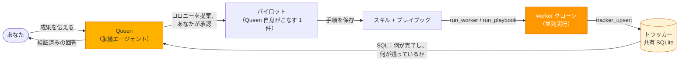

<p align="center">
  <picture>
    <source media="(prefers-color-scheme: dark)" srcset="../assets/readme/banner-dark.webp" />
    
  </picture>
</p>

<p align="center">
  <a href="../../README.md">English</a> |
  <a href="zh-CN.md">简体中文</a> |
  <a href="es.md">Español</a> |
  <a href="hi.md">हिन्दी</a> |
  <a href="pt.md">Português</a> |
  <a href="ja.md">日本語</a> |
  <a href="ru.md">Русский</a> |
  <a href="ko.md">한국어</a>
</p>

<p align="center">
  <a href="https://github.com/aden-hive/hive/blob/main/LICENSE"></a>
  <a href="https://www.ycombinator.com/companies/aden"></a>
  <a href="https://discord.com/invite/MXE49hrKDk"></a>
  <a href="https://x.com/aden_hq"></a>
  <a href="https://www.linkedin.com/company/teamaden/"></a>
</p>

<h3 align="center">実際のビジネス業務をこなす AI エージェントのコロニーを動かす、オープンソースのランタイム。</h3>

<p align="center">
  Queen エージェントに、必要なことを伝えるだけ。Queen はまず最初の 1 件を自分でこなして仕事に何が必要かを見極め、残りは必要な数だけの worker に並列で任せます。結果はすべて共有トラッカーに記録され、いつでもクエリ、監査、そこからの再開ができます。
</p>

<p align="center">
  <a href="../assets/readme/demo.mp4"></a>
  <br />
  <sub>実際の実行を録画したものです。早送りしているのは入力と待ち時間だけで、どれだけ速めたかはバッジに表示されます。<a href="../assets/readme/demo.mp4">実行の全体を見る（MP4）</a>。</sub>
</p>

## デモで起きていたこと

Show HN を準備中のグロースチームが、5 つの開発者ツールについて、各ツール自身による Hacker News でのローンチがどれだけ反響を得たかを知りたいと考えています。この 1 通のメッセージを受けて、Hive は次のように動きました。

1. **Queen に任せる。** Queen は、役割（ここではグロース責任者）と専用のメモリやツールを持つ、長期稼働型のエージェントです。
2. **答えを左右する質問を 1 つだけする：** ローンチ投稿をすべて対象にするか、各製品の最初のローンチだけにするか？ あなたがすべてのローンチを選ぶと、Queen はそのまま作業を続けます。
3. **Queen がコロニーを提案し、あなたが承認する。** 5 製品なら並列ジョブが 5 つ。そこでチャットはコロニーになります。コロニーとは、Queen と、作業に必要な数の worker エージェントの集まりです。
4. **1 件は Queen 自身がこなす。** まず PostHog に取りかかり、ついでに触れただけの投稿ではなく本物のローンチ投稿とみなせるのはどれかを見極め、数値を Hacker News API と照合し、その手順を再利用できるスキルとして保存します。
5. **残りをファンアウトする。** プレイブックが製品ごとに worker を 1 つずつ起動します。各 worker は Queen のスキルに従い、結果をコロニーのトラッカー（共有の SQLite テーブル）に書き込みます。
6. **回答する前に全行を確認し、1 行を修正する。** Cal.com 担当の worker は旧名 Calendso の投稿をカウントしていましたが、その投稿は Show HN でも Launch HN でも YC のローンチでもありませんでした。Queen はその行をクリアし、グラフでは Cal.com をゼロではなく「該当なし」として示します。

どれも事前に組み込まれていたものではありません。描くべきワークフローグラフはなく、Queen は作業の進行に合わせてコロニーを形づくります。何が終わって何が残っているかを把握しているのは、コンテキストウィンドウではなく、ディスク上のトラッカーです。

## クイックスタート

**必要なもの：** Python 3.11+、Node.js 20+、git。`uv` と `ripgrep` がなければクイックスタートがインストールし、Node のインストールも提案します。

**それとモデルも必要です。** クイックスタートでは、次のいずれでも設定できます：

- Anthropic、OpenAI、Google Gemini、Groq、Cerebras、OpenRouter のいずれかの API キー
- すでに契約しているコーディング向けサブスクリプション：Claude Code、OpenAI Codex、Kimi Code、MiniMax、Z.AI、Antigravity
- Hive LLM
- Ollama 経由のローカルモデル（キーは一切不要）

```bash
git clone https://github.com/aden-hive/hive.git
cd hive
./quickstart.sh          # macOS / Linux
.\quickstart.ps1         # Windows (PowerShell 5.1+)
```

クイックスタートは、ワークスペース用の Python 環境を 1 つ作成し、API キーを暗号化して `~/.hive` 配下に保存し、使用するモデルを尋ね、ダッシュボードをビルドして `http://127.0.0.1:8787` で開きます。次回からは、リポジトリで `hive open` を実行してください。

> [!NOTE]
> Hive は pip パッケージではなく、`uv` ワークスペースです。`pip install -e .` では動作しないプレースホルダーがインストールされるだけなので、クイックスタートを使ってください。

**あとは**、ホーム画面にタスクを入力して任せる Queen を選ぶか、**プロンプトライブラリ**（Prompt Library）を開いて、用意されたプロンプトを想定先の Queen にそのまま送るだけです。

## 仕組み



Hive の**実行プリミティブはひとつだけ**、エージェントループです。Queen 自体がエージェントループであり、すべての worker はそのクローンです。各 worker は固有のタスク、より絞り込まれたツールセット、厳格な予算を持ちます。オーケストレーションはコンパイル済みのグラフではなく、ツール呼び出しで行います：

- **`run_worker`** はタスクをファンアウトしてすぐに戻るので、worker の実行中も Queen はあなたと会話を続けられます。デフォルトでは同時に 4 つまで実行し、残りは順番を待ちます。各 worker の報告は、新しいターンとして Queen の会話に届きます。
- **トラッカー**はコロニーの共有状態です。Queen がテーブルと、worker が書き込める列を定義し、worker は作業単位ごとに 1 行を upsert し、Queen は SQL で進捗を確認します。実体はディスク上のファイル `~/.hive/colonies/<name>/tracker/tracker.db` です。
- **`run_playbook`** は、実証済みの手順を全行に対して実行します。バックオフ付きのリトライ、レート制限付きのレーン、失敗し続ける行を集めるデッドレターリストを備えています。「残り」は毎回トラッカーへの新しいクエリで求めるため、プレイブックを再実行すれば止まったところから再開します。

**[アーキテクチャ概要](../architecture/README.md)** では、ループ、ツール群、メモリ、人間による監督、そしてクラッシュしても状態が失われない仕組みを詳しく解説しています。

<table>
  <tr>
    <td width="50%"><br /><sub><b>ホーム。</b>あなたの Queen とそのコロニーを 1 枚のマップで一望できます。タスクを伝え、誰に任せるかを選びます。</sub></td>
    <td width="50%"><br /><sub><b>Worker。</b>作業単位ごとに 1 つずつ。それぞれ固有のタスクと予算を持ち、すべて Queen に報告します。</sub></td>
  </tr>
  <tr>
    <td width="50%"><br /><sub><b>トラッカー。</b>worker が終わるたびに結果が共有テーブルに入り、そのままクエリ、エクスポート、そこからの再開に使えます。</sub></td>
    <td width="50%"><br /><sub><b>結果。</b>出典とグラフを添えた検証済みの回答が、チャットにそのまま届きます。</sub></td>
  </tr>
</table>

## 主な機能

**役割と記憶を持つ Queen。** Hive には 13 人のペルソナ Queen が付属しています。6 人は最初から有効になっており（グロース、RevOps、コンテンツ、リードジェネレーション、アウトバウンド、ブランド＆デザイン）、残りは組織図（Org Chart）から採用できます。独自の Queen を作ることも可能です。各 Queen は作業しながら Markdown のメモリにメモを残し、関連する過去の会話は自動的にコンテキストへ呼び出されます。

**プロセス内で動く組み込みツール。** シェルコマンドとバックグラウンドジョブ、ファイル編集、高速なコード検索、PDF、添付ファイルと画像、Web スクレイピング、グラフ（ECharts と Mermaid）、CSV ファイル、Hive LLM による画像生成。どれも Hive 自体の中で動くので、ツールサーバーを起動する必要はありません。

**あなたのブラウザをエージェントが操作。** Hive Browser Bridge 拡張機能を使えば、エージェントはログイン済みのあなた自身の Chrome で作業できます。worker ごとに専用のタブグループが割り当てられます。

**スキル。** オープンな [Agent Skills](https://agentskills.io) 形式で書かれた、再利用可能な指示です。Hive には一式が同梱されているほか、手順の有効性が確かめられると Queen が新しいスキルを書きます。すべてのスキルはスキルライブラリ（Skills Library）で管理できます。

**あらゆる MCP サーバー。** `hive mcp add` で追加すると、そのツールは組み込みツールと同じ許可リストに加わります。[`tools/`](../../tools/src/aden_tools/tools) にある統合カタログ全体（GitHub、Gmail、HubSpot、Slack、Notion ほか多数）も、1 つの MCP サーバーとして動作します。詳しくは [docs/tools.md](../tools.md) を参照してください。

**不在中も動き続ける。** コロニーは cron、インターバル、webhook のトリガーで自ら起動できます。コロニーごとにオプトインできる **Sentinel** は、Queen が止まるたびに様子を見て、続行を促すか、Hive の受信トレイ、Telegram、Slack を通じてあなたにエスカレーションします。あなたが返信すれば、Queen はすぐに作業を再開します。

**障害に強い設計。** すべてのエージェントは状態をディスクに保存し、クラッシュや再起動のあとも、止まった地点からそのまま再開します。大きなツール結果はコンテキストにあふれさせずファイルに書き出し、長いセッションは自動でコンパクションされ、行き詰まったターンやループしているターンは検出されます。さらに、すべての worker はツール呼び出し回数の厳格な上限のもとで動作します。

**あらゆるモデル。** [LiteLLM](https://docs.litellm.ai/docs/providers) がサポートするものなら何でも使えます。OpenAI、Anthropic、Gemini、OpenRouter、Hive LLM、OpenAI 互換の任意のエンドポイント、Ollama 経由のローカルモデルなどです。worker は Queen とは別のモデルで動かすこともでき、テキスト専用モデルでもビジョンフォールバックによって画像を扱えます。

## Hive はあなたに向いているか？

難しいのがもはやモデルではなく、その周りのすべてになったとき、Hive は真価を発揮します：

- リード、アカウント、チケット、リポジトリ、ドキュメントなど、**似た作業単位が大量にある**プロセスを、並列に、しかも毎回同じやり方で処理したい。
- **何時間も、あるいはスケジュールに沿って動き続け**、再起動にも耐えなければならない作業がある。
- チャットで読むだけでなく、**確認、クエリ、監査**が必要な結果を扱う。
- 重要な判断については、**人間が主導権を握り続けたい**。

単発のプロンプトや使い捨てのスクリプトなら、普通のエージェントのほうがシンプルです。

## ドキュメント

- [はじめに](../getting-started.md)：セットアップの詳細
- [アーキテクチャ概要](../architecture/README.md)：コロニー、ループ、ツール、メモリがどう組み合わさっているか
- 主要コンセプト：[コロニー](../key_concepts/colony.md)、[Queen](../key_concepts/queen.md)、[worker](../key_concepts/worker_agent.md)、[連携](../key_concepts/coordination.md)、[ループ](../key_concepts/the_loop.md)、[目標と成果](../key_concepts/goals_outcome.md)、[コロニーが改善していく仕組み](../key_concepts/improvement.md)
- [ツール](../tools.md)：組み込みツール、MCP サーバー、統合カタログ
- [設定](../configuration.md) と [開発者ガイド](../developer-guide.md)
- [ロードマップ](../roadmap.md)：V1 で提供される機能と、まだ残っている課題
- [docs.adenhq.com](https://docs.adenhq.com/)：オンラインドキュメント

## よくある質問

**Hive はどのモデルに対応していますか？**
[LiteLLM](https://docs.litellm.ai/docs/providers) がサポートするすべてのプロバイダーと、OpenAI 互換の任意のエンドポイントに対応しています。Claude Code や OpenAI Codex といったコーディング向けサブスクリプションを含め、主要なものはクイックスタートで設定できます。それ以外は [docs/configuration.md](../configuration.md) を参照してください。

**ローカルモデルで動かせますか？**
はい。クイックスタートで Ollama を選ぶか、Ollama をローカルで起動したうえで `ollama/llama3` などのモデルを指定してください。

**他のエージェントフレームワークと何が違うのですか？**
多くのフレームワークでは、エージェントのグラフを設計し、その入出力を配線する必要があります。Hive のエージェントは 1 種類だけです。Queen はエージェントループであり、すべての worker はそのクローンです。オーケストレーションは実行時にツール呼び出しで行われ、エージェント同士はエッジに沿ってメッセージを受け渡すのではなく、共有の SQL トラッカーを通じて連携します。永続化、再開、予算、コンパクション、監督はすべてこの 1 つのループに組み込まれているため、どのエージェントもそれらを備えています。

**データはどこに保存されますか？**
あなたのマシン上です。セッション、コロニー、トラッカー、メモリは `~/.hive`（または `HIVE_HOME` が指す場所）配下のプレーンなファイルで、API キーもそこに暗号化して保存されます。

**コストはどう抑えればよいですか？**
各 worker はターン数とツール呼び出し回数の厳格な上限のもとで動作するため、行き詰まった worker は自動的に止まります。同時に実行される worker の数にも上限があります。モデル呼び出しはすべて計測されます。金額ベースの支出上限は、まだありません。

**エージェントに自前のツールや API を使わせられますか？**
はい。組み込みのシェルとブラウザ、追加した任意の MCP サーバー、そしてあなたの手順を教えるスキルを通じて使えます。

**Hive はオープンソースですか？**
はい。[Apache License 2.0](../../LICENSE) のもとで公開されています。

## 貢献

コントリビューションを歓迎します。特にツール、統合、スキルは大歓迎です（[#2805](https://github.com/aden-hive/hive/issues/2805)）。まず [CONTRIBUTING.md](../../CONTRIBUTING.md) を読み、プルリクエストを開く前に Issue にアサインしてもらってください。Issue にコメントすれば、メンテナーがアサインします。再現手順や具体的な提案を含む Issue が優先されます。

## コミュニティ

- [Discord](https://discord.com/invite/MXE49hrKDk)：質問、機能リクエスト、ディスカッション
- [X / Twitter](https://x.com/aden_hq) と [LinkedIn](https://www.linkedin.com/company/teamaden/)：最新情報
- [HoneyComb](http://honeycomb.open-hive.com/)：AI エージェントがどの仕事を自動化しつつあるかを追跡するコミュニティマーケット。お金ではなくコンピュートトークンで、仕事をロングまたはショートできます。

エンジニアリング、リサーチ、市場開拓（go-to-market）の各分野で**採用中です**。[募集中のポジションを見る](https://jobs.adenhq.com/a8cec478-cdbc-473c-bbd4-f4b7027ec193/applicant)。

## セキュリティ

脆弱性を報告する場合は、[SECURITY.md](../../SECURITY.md) をご覧ください。

## ライセンス

Apache License 2.0。詳しくは [LICENSE](../../LICENSE) をご覧ください。

## スター履歴

<a href="https://www.star-history.com/?type=date&repos=aden-hive%2Fhive">
 <picture>
   <source media="(prefers-color-scheme: dark)" srcset="https://api.star-history.com/chart?repos=aden-hive/hive&type=date&theme=dark&legend=top-left&sealed_token=vfX1DG8w_KTkonUUtIEjFRLvBopgDzxQpyb8hiYT22sobcDIpvQiMciZghLsDu5hyU3LJs-ZddFjl8eYFx5zRrY-kcMRsfyQ3vAiacsroPoqgRYmZaES3Q" />
   <source media="(prefers-color-scheme: light)" srcset="https://api.star-history.com/chart?repos=aden-hive/hive&type=date&legend=top-left&sealed_token=vfX1DG8w_KTkonUUtIEjFRLvBopgDzxQpyb8hiYT22sobcDIpvQiMciZghLsDu5hyU3LJs-ZddFjl8eYFx5zRrY-kcMRsfyQ3vAiacsroPoqgRYmZaES3Q" />
   
 </picture>
</a>

---

<p align="center">サンフランシスコから 🔥 情熱を込めて</p>
