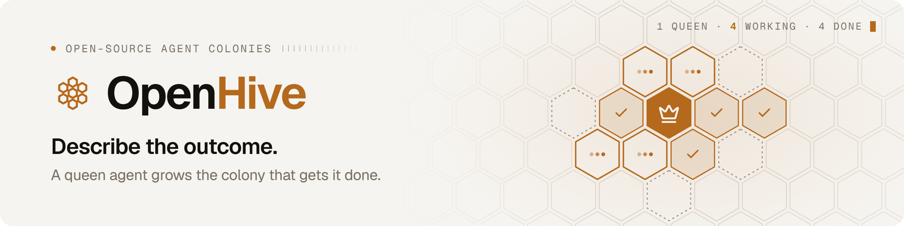
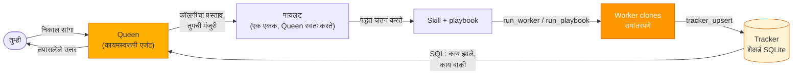
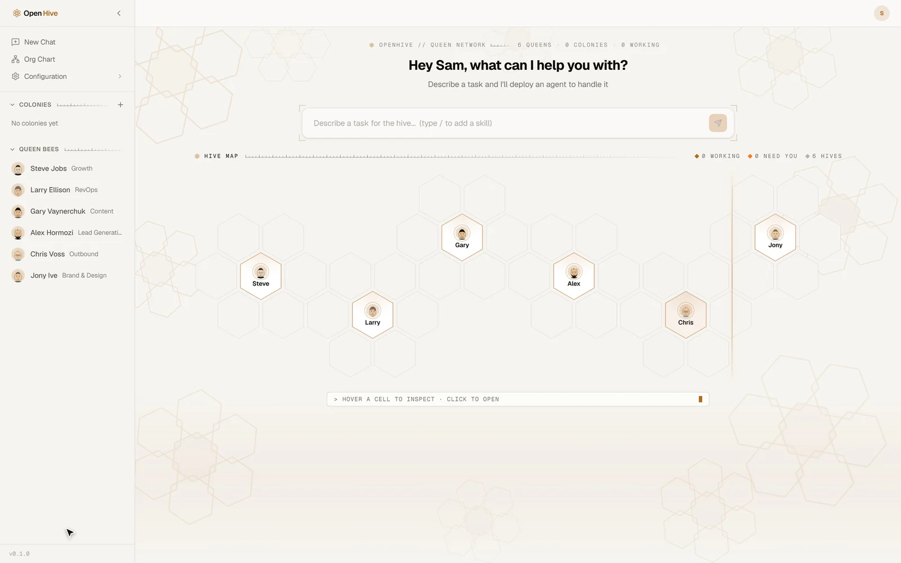
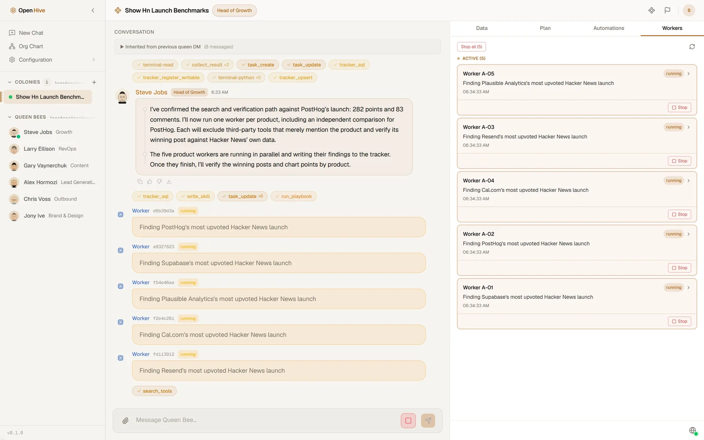
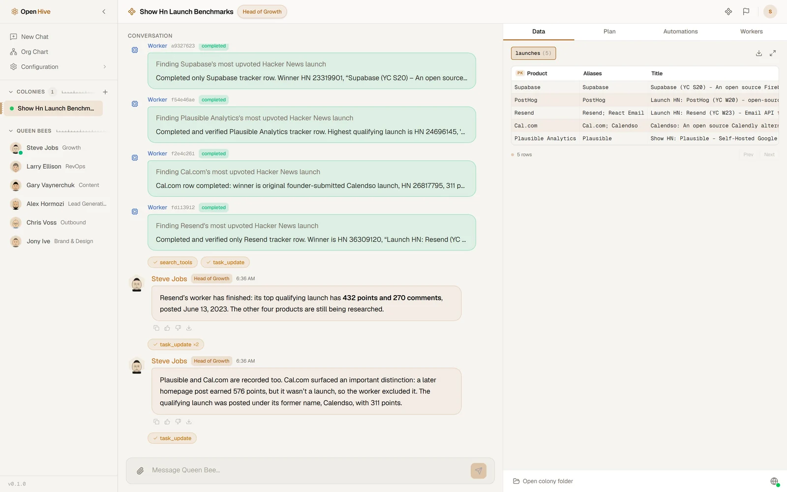
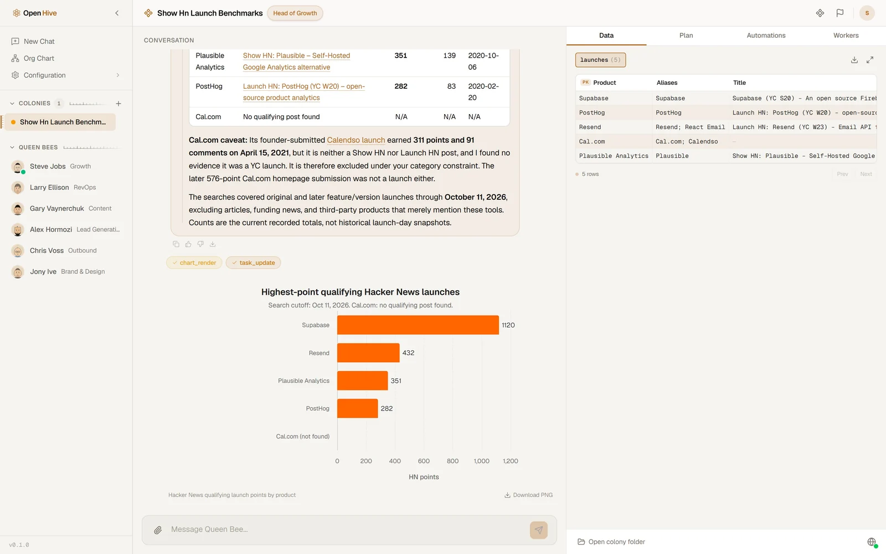

<p align="center">
  <picture>
    <source media="(prefers-color-scheme: dark)" srcset="../assets/readme/banner-dark.webp" />
    
  </picture>
</p>

<p align="center">
  <a href="../../README.md">English</a> |
  <a href="zh-CN.md">简体中文</a> |
  <a href="es.md">Español</a> |
  <a href="hi.md">हिन्दी</a> |
  <a href="mr.md">मराठी</a> |
  <a href="pt.md">Português</a> |
  <a href="ja.md">日本語</a> |
  <a href="ru.md">Русский</a> |
  <a href="ko.md">한국어</a>
</p>

<p align="center">
  <a href="https://github.com/aden-hive/hive/blob/main/LICENSE"></a>
  <a href="https://www.ycombinator.com/companies/aden"></a>
  <a href="https://discord.com/invite/MXE49hrKDk"></a>
  <a href="https://x.com/aden_hq"></a>
  <a href="https://www.linkedin.com/company/teamaden/"></a>
</p>

<h3 align="center">प्रत्यक्ष व्यावसायिक काम करणाऱ्या AI एजंट्सच्या कॉलन्यांसाठी एक ओपन-सोर्स रनटाइम.</h3>

<p align="center">
  Queen एजंटला तुम्हाला काय हवे ते सांगा. कामात काय-काय लागते हे समजून घेण्यासाठी ती पहिला भाग स्वतः करते, आणि उरलेले काम गरजेइतक्या समांतर workers कडे सोपवते. प्रत्येक निकाल एका शेअर्ड tracker मध्ये नोंदवला जातो, ज्यावर तुम्ही query चालवू शकता, ऑडिट करू शकता आणि जिथे काम थांबले होते तिथून पुन्हा सुरू करू शकता.
</p>

<p align="center">
  <a href="../assets/readme/demo.mp4"></a>
  <br />
  <sub>एक खराखुरा रन. फक्त टायपिंग आणि प्रतीक्षेचे भाग वेगवान केले आहेत, आणि बॅज सांगतो की किती. <a href="../assets/readme/demo.mp4">संपूर्ण रन पहा (MP4)</a>.</sub>
</p>

## तुम्ही नुकतेच काय पाहिले

Show HN ची तयारी करणाऱ्या एका ग्रोथ टीमला जाणून घ्यायचे आहे की पाच डेव्हलपर टूल्सच्या स्वतःच्या लॉन्चेसना Hacker News वर कसा प्रतिसाद मिळाला. त्या एकाच मेसेजवर Hive ने हे केले:

1. **तुम्ही हे काम एका Queen ला सोपवता.** Queens या दीर्घकाळ चालणाऱ्या एजंट्स आहेत, ज्यांची एक भूमिका असते (इथे, Head of Growth) आणि ज्यांच्याकडे स्वतःची मेमरी व स्वतःची टूल्स असतात.
2. **ती फक्त तो एक प्रश्न विचारते ज्यामुळे उत्तर बदलते:** प्रत्येक लॉन्च पोस्ट, की फक्त प्रत्येक प्रॉडक्टचे मूळ लॉन्च? तुम्ही "प्रत्येक लॉन्च" निवडता, आणि ती पुढे जाते.
3. **ती एका कॉलनीचा प्रस्ताव मांडते, आणि तुम्ही त्याला मंजुरी देता.** पाच प्रॉडक्ट्स म्हणजे पाच समांतर कामे, त्यामुळे चॅटचे रूपांतर कॉलनीत होते: Queen, आणि कामाला लागतील तितके worker एजंट्स.
4. **एक काम ती स्वतः करते.** ती सर्वप्रथम PostHog घेते, खरी लॉन्च पोस्ट कशाला मानायचे आणि केवळ ओझरता उल्लेख कशाला, ते ठरवते, आकड्यांची Hacker News API शी पडताळणी करते, आणि ती पद्धत पुन्हा वापरता येणारी skill म्हणून जतन करते.
5. **मग ती काम वाटून देते.** एक playbook प्रत्येक प्रॉडक्टसाठी एक worker सुरू करतो. प्रत्येक worker तिच्या skill चे पालन करतो आणि आपला निकाल कॉलनीच्या tracker मध्ये लिहितो, जी एक शेअर्ड SQLite टेबल आहे.
6. **उत्तर देण्यापूर्वी ती प्रत्येक ओळ तपासते, आणि एक ओळ दुरुस्त करते.** Cal.com च्या worker ने त्याच्या जुन्या नावाची, Calendso ची, एक पोस्ट मोजली होती, पण ती पोस्ट Show HN, Launch HN किंवा YC लॉन्च नव्हती. ती ती ओळ रिकामी करते, आणि चार्ट Cal.com साठी शून्याऐवजी "सापडले नाही" असे दाखवतो.

यापैकी काहीही आधीपासून जोडून ठेवलेले नव्हते. आखावा लागणारा कोणताही workflow graph नाही: काम जसजसे पुढे सरकते तसतशी Queen कॉलनीला आकार देत जाते, आणि काय पूर्ण झाले व काय बाकी आहे याचा हिशेब context window नव्हे, तर डिस्कवरील tracker ठेवतो.

## झटपट सुरुवात

**तुम्हाला लागेल:** Python 3.11+, Node.js 20+ आणि git. `uv` आणि `ripgrep` नसतील तर quickstart ते इन्स्टॉल करतो, आणि Node इन्स्टॉल करण्याचा पर्यायही देतो.

**आणि एक मॉडेल.** quickstart यापैकी कोणतेही सेट अप करतो:

- Anthropic, OpenAI, Google Gemini, Groq, Cerebras किंवा OpenRouter ची API key
- तुम्ही आधीपासून पैसे भरत असलेली कोडिंग सबस्क्रिप्शन: Claude Code, OpenAI Codex, Kimi Code, MiniMax, Z.AI किंवा Antigravity
- Hive LLM
- Ollama द्वारे लोकल मॉडेल, कोणत्याही key शिवाय

```bash
git clone https://github.com/aden-hive/hive.git
cd hive
./quickstart.sh          # macOS / Linux
.\quickstart.ps1         # Windows (PowerShell 5.1+)
```

quickstart संपूर्ण वर्कस्पेससाठी एकच Python एनव्हायरनमेंट तयार करतो, तुमची API key एन्क्रिप्ट करून `~/.hive` अंतर्गत साठवतो, कोणते मॉडेल वापरायचे ते विचारतो, डॅशबोर्ड बिल्ड करतो आणि तो `http://127.0.0.1:8787` वर उघडतो. पुढच्या वेळी रिपॉझिटरीमधून `hive open` चालवा.

> [!NOTE]
> ही रिपॉझिटरी एक `uv` वर्कस्पेस आहे: तिच्या रूटमध्ये `pip install -e .` चालवल्यास एक प्लेसहोल्डर इन्स्टॉल होतो जो चालणार नाही, म्हणून quickstart वापरा. रिपॉझिटरीशिवाय, `pip install "aden-hive[tools]"` PyPI वरून Hive इन्स्टॉल करते; त्यानंतर `hive open` चालवा. एखादे ऐच्छिक पॅकेज (उदाहरणार्थ, चॅट-अॅप चॅनेल) जोडण्यासाठी [Optional packages](../optional-packages.md) पहा. Hive च्या agent loop आणि मॉडेल्सवर स्वतःचा प्रोजेक्ट बनवण्यासाठी `aden-hive` वर अवलंबून राहा: [Building on Hive](../building-on-hive.md) पहा.

**त्यानंतर** होम स्क्रीनवर एखादे टास्क टाइप करा आणि ते कोणत्या Queen ला द्यायचे ते निवडा, किंवा **Prompt Library** उघडा आणि एखादा तयार प्रॉम्प्ट थेट त्या Queen ला पाठवा, जिच्यासाठी तो लिहिला आहे.

## हे कसे काम करते



Hive मध्ये **एकच एक्झिक्युशन प्रिमिटिव्ह** आहे: एजंट लूप. Queen ही स्वतःदेखील एक एजंट लूप आहे, आणि प्रत्येक worker तिचा एक clone आहे, ज्याचे स्वतःचे टास्क, टूल्सचा मर्यादित संच आणि कडक बजेट असते. ऑर्केस्ट्रेशन म्हणजे एक टूल कॉल आहे, कंपाइल केलेला graph नव्हे:

- **`run_worker`** कामे workers मध्ये वाटून लगेच परत येतो, त्यामुळे workers चालू असतानाही Queen तुमच्याशी बोलत राहते. डिफॉल्टनुसार एका वेळी चार workers चालतात; बाकीचे आपल्या पाळीची वाट पाहतात. प्रत्येक worker चा रिपोर्ट Queen च्या संभाषणात नवीन टर्न म्हणून येतो.
- **Tracker** ही कॉलनीची शेअर्ड स्टेट आहे. Queen टेबल ठरवते, तसेच workers कोणत्या कॉलम्समध्ये लिहू शकतात तेही; workers कामाच्या प्रत्येक एककासाठी एक ओळ upsert करतात, आणि Queen SQL च्या मदतीने प्रगती तपासते. ही डिस्कवरील एक फाइल आहे: `~/.hive/colonies/<name>/tracker/tracker.db`.
- **`run_playbook`** एक सिद्ध झालेली पद्धत प्रत्येक ओळीवर चालवतो, ज्यात backoff सह retries, rate-limited lanes, आणि वारंवार अयशस्वी होणाऱ्या ओळींसाठी dead-letter यादी असते. "काय बाकी आहे" ही नेहमी tracker वरची ताजी query असते, त्यामुळे playbook पुन्हा चालवल्यास काम जिथे थांबले होते तिथूनच पुढे सुरू होते.

**[आर्किटेक्चरचा आढावा](../architecture/README.md)** यात अधिक खोलात जातो: लूप, टूल सरफेस, मेमरी, मानवी देखरेख, आणि क्रॅशनंतर स्टेट कशी टिकून राहते.

<table>
  <tr>
    <td width="50%"><br /><sub><b>होम.</b> तुमच्या Queens आणि त्यांच्या कॉलन्या, एकाच नकाशावर. टास्क सांगा आणि ते कोण घेणार ते निवडा.</sub></td>
    <td width="50%"><br /><sub><b>Workers.</b> कामाच्या प्रत्येक एककासाठी एक, प्रत्येकाचे स्वतःचे टास्क आणि बजेट, आणि सर्व जण Queen ला रिपोर्ट करतात.</sub></td>
  </tr>
  <tr>
    <td width="50%"><br /><sub><b>Tracker.</b> workers काम पूर्ण करतात तसे निकाल एका शेअर्ड टेबलमध्ये येत जातात, जिथे त्यावर query चालवता येते, ते export करता येतात किंवा तिथूनच काम पुन्हा सुरू करता येते.</sub></td>
    <td width="50%"><br /><sub><b>निकाल.</b> स्रोत आणि चार्टसह तपासलेले उत्तर, थेट चॅटमध्ये.</sub></td>
  </tr>
</table>

## यात काय आहे

**जबाबदारी आणि मेमरी असलेल्या Queens.** Hive सोबत तेरा persona Queens येतात. त्यापैकी सहा सुरुवातीपासूनच सक्रिय आहेत (Growth, RevOps, Content, Lead Generation, Outbound, आणि Brand & Design); बाकीच्यांना Org Chart मधून नियुक्त करा, किंवा स्वतःची Queen तयार करा. प्रत्येक Queen काम करताना markdown मेमरीमध्ये नोट्स ठेवते, आणि संबंधित जुनी संभाषणे आपोआप तिच्या context मध्ये येतात.

**मोजता येणारी मेमरी.** Queen तुम्हाला एका सत्रातून दुसऱ्या सत्रात लक्षात ठेवते. ती काम करताना तुमच्याबद्दल नोट्स लिहिते, प्रत्येक मेसेजपूर्वी संबंधित जुनी संभाषणे तिच्यासमोर ठेवली जातात, आणि तुम्ही आधीच सांगितलेली गोष्ट पुन्हा विचारण्यापूर्वी ती आपली मेमरी तपासते. आम्ही याचे [LongMemEval](../memory-benchmark.md) वर बेंचमार्किंग करतो, Hive मधून एंड-टू-एंड चालवून आणि अधिकृत judge कडून ग्रेड करून, उत्तर `gpt-6.1-sol` देत आहे:

|                                          | LongMemEval-S | LongMemEval-M |
|------------------------------------------|---------------|---------------|
| प्रत्येक प्रश्नामागील इतिहास               | ~115k टोकन्स   | ~1.1M टोकन्स   |
| **Hive**                                 | **88.4%**     | **82.0%**     |
| तेच मॉडेल संपूर्ण इतिहास वाचते              | 96.8%         | मावत नाही      |

संपूर्ण इतिहास मॉडेलच्या context मध्ये मावत असेल, तेव्हा तो सगळा वाचणे हे अजूनही Hive च्या मेमरीपेक्षा अधिक अचूक ठरते. तो मावत नसेल, जसे LongMemEval-M मध्ये, तेव्हा मेमरी हाच एकमेव पर्याय आहे. [बेंचमार्क पानावर](../memory-benchmark.md) पद्धत, प्रकारानुसार निकाल, इतर मेमरी सिस्टीम्सशी तुलना आणि मर्यादा दिलेल्या आहेत.

**प्रक्रियेतच चालणारी बिल्ट-इन टूल्स.** Shell कमांड्स आणि बॅकग्राउंड जॉब्स, फाइल एडिटिंग, जलद कोड सर्च, PDF, अटॅचमेंट्स आणि इमेजेस, वेब स्क्रॅपिंग, चार्ट्स (ECharts आणि Mermaid), CSV फाइल्स, आणि Hive LLM द्वारे इमेज जनरेशन. ती Hive च्या आतच चालतात, कोणताही टूल सर्व्हर सुरू करावा लागत नाही.

**तुमचा ब्राउझर, तुमच्या एजंट्सच्या हातात.** Hive Browser Bridge एक्सटेन्शनमुळे एजंट्स तुमच्या स्वतःच्या Chrome मध्ये काम करू शकतात, जिथे तुम्ही आधीच लॉग इन आहात. प्रत्येक worker ला स्वतःचा वेगळा टॅब ग्रुप मिळतो.

**Skills.** खुल्या [Agent Skills](https://agentskills.io) फॉरमॅटमधील पुन्हा वापरता येणाऱ्या सूचना. Hive सोबत काही skills येतात, एखादी पद्धत यशस्वी ठरली की Queens नवीन skills लिहितात, आणि तुम्ही त्या सर्व Skills Library मध्ये व्यवस्थापित करता.

**कोणताही MCP server.** `hive mcp add` ने MCP server जोडा, आणि त्याची टूल्स बिल्ट-इन टूल्सच्या allowlists मध्येच सामील होतात. [`tools/`](../../tools/src/aden_tools/tools) मधील संपूर्ण इंटिग्रेशन कॅटलॉग (GitHub, Gmail, HubSpot, Slack, Notion आणि बरेच काही) देखील एक MCP server म्हणून चालतो; [docs/tools.md](../tools.md) पहा.

**तुम्ही नसतानाही चालते.** कॉलन्या cron, interval किंवा webhook ट्रिगर्सवर स्वतःहून जाग्या होऊ शकतात. **Sentinel**, जो प्रत्येक कॉलनीसाठी स्वतंत्रपणे चालू करावा लागतो, Queen जेव्हा जेव्हा थांबते तेव्हा तिच्यावर लक्ष ठेवतो: तिला पुढे जाण्याची सूचना देतो, किंवा Hive inbox, Telegram किंवा Slack द्वारे प्रकरण तुमच्यापर्यंत पोहोचवतो, आणि तुम्ही उत्तर देताच Queen पुन्हा काम सुरू करते.

**टिकून राहण्यासाठी बनवलेले.** प्रत्येक एजंट आपली स्टेट डिस्कवर जतन करतो आणि क्रॅश किंवा रीस्टार्टनंतर नेमका जिथे थांबला होता तिथून पुन्हा सुरू होतो. मोठे टूल निकाल context भरून टाकण्याऐवजी फाइल्समध्ये जातात, लांब सेशन्स आपोआप compact होतात, अडकलेले किंवा लूपमध्ये फिरणारे टर्न्स पकडले जातात, आणि प्रत्येक worker कडक tool-call बजेटच्या आत चालतो.

**कोणतेही मॉडेल.** [LiteLLM](https://docs.litellm.ai/docs/providers) जे काही सपोर्ट करते ते सर्व, ज्यात OpenAI, Anthropic, Gemini, OpenRouter, Hive LLM, कोणताही OpenAI-compatible endpoint आणि Ollama द्वारे लोकल मॉडेल्स यांचा समावेश आहे. Workers आपल्या Queen पेक्षा वेगळ्या मॉडेलवर चालू शकतात, आणि फक्त मजकूर समजणारी मॉडेल्सही vision fallback मुळे इमेजेस पाहू शकतात.

## Hive तुमच्यासाठी आहे का?

मॉडेल हा अवघड भाग राहत नाही आणि त्याच्या भोवतालचे सर्व काही अवघड ठरते, तेव्हा Hive आपली किंमत वसूल करतो:

- अशी प्रक्रिया ज्यात **कामाची अनेक सारखी एकके** आहेत, जसे लीड्स, अकाउंट्स, तिकिटे, रिपॉझिटरीज किंवा दस्तऐवज, आणि ती तुम्हाला समांतरपणे आणि दरवेळी एकाच पद्धतीने पूर्ण करायची आहेत.
- असे काम जे **तासन्तास किंवा ठरलेल्या वेळापत्रकानुसार चालते** आणि रीस्टार्टनंतरही टिकले पाहिजे.
- असे निकाल जे तुम्हाला फक्त चॅटमध्ये वाचायचे नाहीत, तर **तपासायचे, query करायचे आणि ऑडिट करायचे** आहेत.
- महत्त्वाच्या निर्णयांवर **माणसाचे नियंत्रण** राहील.

एकाच प्रॉम्प्टसाठी किंवा एकदाच चालवायच्या स्क्रिप्टसाठी साधा एजंट अधिक सोपा पडतो.

## दस्तऐवजीकरण

- [सुरुवात करा](../getting-started.md): सेटअपचे सविस्तर वर्णन
- [आर्किटेक्चरचा आढावा](../architecture/README.md): कॉलन्या, लूप, टूल्स आणि मेमरी एकमेकांशी कशा जोडल्या जातात
- मूलभूत संकल्पना: [कॉलनी](../key_concepts/colony.md), [Queen](../key_concepts/queen.md), [workers](../key_concepts/worker_agent.md), [समन्वय](../key_concepts/coordination.md), [लूप](../key_concepts/the_loop.md), [उद्दिष्टे आणि निकाल](../key_concepts/goals_outcome.md), [कॉलन्या कशा सुधारतात](../key_concepts/improvement.md)
- [टूल्स](../tools.md): बिल्ट-इन टूल्स, MCP servers आणि इंटिग्रेशन कॅटलॉग
- [कॉन्फिगरेशन](../configuration.md) आणि [डेव्हलपर मार्गदर्शक](../developer-guide.md)
- [मेमरी बेंचमार्क](../memory-benchmark.md): LongMemEval चे निकाल, पद्धत आणि मर्यादा
- [रोडमॅप](../roadmap.md): V1 मध्ये काय आहे आणि काय अजून बाकी आहे
- [docs.adenhq.com](https://docs.adenhq.com/): ऑनलाइन दस्तऐवजीकरण

## वारंवार विचारले जाणारे प्रश्न (FAQ)

**Hive कोणती मॉडेल्स सपोर्ट करतो?**
[LiteLLM](https://docs.litellm.ai/docs/providers) सपोर्ट करत असलेला कोणताही प्रोव्हायडर, तसेच कोणताही OpenAI-compatible endpoint. quickstart सर्वसामान्य पर्याय सेट अप करतो, ज्यात Claude Code आणि OpenAI Codex सारख्या कोडिंग सबस्क्रिप्शन्सचाही समावेश आहे; बाकीच्यांसाठी [docs/configuration.md](../configuration.md) पहा.

**मी हे लोकल मॉडेल्ससह चालवू शकतो का?**
हो. quickstart मध्ये Ollama निवडा, किंवा Ollama लोकली चालू ठेवून `ollama/llama3` सारखे एखादे मॉडेल सेट करा.

**हे इतर एजंट फ्रेमवर्क्सपेक्षा कसे वेगळे आहे?**
बहुतेक फ्रेमवर्क्समध्ये तुम्हाला एजंट्सचा एक graph डिझाइन करावा लागतो आणि त्यांचे इनपुट-आउटपुट एकमेकांशी जोडावे लागतात. Hive मध्ये एजंटचा एकच प्रकार आहे: Queen ही एक एजंट लूप आहे, आणि प्रत्येक worker तिचा clone आहे. ऑर्केस्ट्रेशन रनटाइमला टूल कॉल्सद्वारे होते, आणि एजंट्स edges वरून मेसेज पाठवण्याऐवजी एका शेअर्ड SQL tracker द्वारे एकमेकांशी समन्वय साधतात. परसिस्टन्स, resume, बजेट्स, compaction आणि देखरेख हे सर्व त्याच एका लूपमध्ये आहे, त्यामुळे प्रत्येक एजंटला या सुविधा मिळतात.

**माझा डेटा कुठे राहतो?**
तुमच्या स्वतःच्या मशीनवर. सेशन्स, कॉलन्या, trackers आणि मेमरी `~/.hive` (किंवा `HIVE_HOME` जिकडे निर्देश करतो तिथे) अंतर्गत साध्या फाइल्स म्हणून राहतात, आणि API keys तिथेच एन्क्रिप्ट करून ठेवल्या जातात.

**खर्च नियंत्रणात कसा ठेवू?**
प्रत्येक worker टर्न्स आणि टूल कॉल्सच्या कडक मर्यादांच्या आत चालतो, त्यामुळे अडकलेला worker आपोआप थांबतो, आणि एकाच वेळी चालणाऱ्या workers ची संख्याही मर्यादित आहे. प्रत्येक मॉडेल कॉलचा वापर मोजला जातो. डॉलरमध्ये खर्च मर्यादा ठरवण्याची सोय अजून नाही.

**एजंट्स माझी स्वतःची टूल्स आणि API वापरू शकतात का?**
हो: बिल्ट-इन shell आणि ब्राउझरद्वारे, तुम्ही जोडलेल्या कोणत्याही MCP server द्वारे, आणि त्यांना तुमच्या प्रक्रिया शिकवणाऱ्या skills द्वारे.

**Hive ओपन-सोर्स आहे का?**
हो, [Apache License 2.0](../../LICENSE) अंतर्गत.

## योगदान द्या

योगदानाचे स्वागत आहे, विशेषतः टूल्स, इंटिग्रेशन्स आणि skills साठी ([#2805](https://github.com/aden-hive/hive/issues/2805)). आधी [CONTRIBUTING.md](../../CONTRIBUTING.md) वाचा, आणि pull request उघडण्यापूर्वी एखाद्या issue वर स्वतःला असाइन करून घ्या: issue वर कमेंट करा आणि एखादा मेंटेनर तुम्हाला असाइन करेल. ज्या issues मध्ये रिप्रोडक्शन स्टेप्स किंवा ठोस प्रस्ताव असतो, त्यांना प्राधान्य दिले जाते.

## समुदाय

- प्रश्न, फीचर रिक्वेस्ट्स आणि चर्चेसाठी [Discord](https://discord.com/invite/MXE49hrKDk)
- अपडेट्ससाठी [X / Twitter](https://x.com/aden_hq) आणि [LinkedIn](https://www.linkedin.com/company/teamaden/)
- [HoneyComb](http://honeycomb.open-hive.com/): AI एजंट्स कोणत्या नोकऱ्या ऑटोमेट करत आहेत याचा मागोवा घेणारा कम्युनिटी मार्केट. पैशाने नव्हे, तर compute tokens ने एखाद्या जॉबवर लाँग किंवा शॉर्ट जा.

इंजिनिअरिंग, रिसर्च आणि गो-टू-मार्केट विभागांमध्ये **आम्ही भरती करत आहोत**. [खुली पदे पहा](https://jobs.adenhq.com/a8cec478-cdbc-473c-bbd4-f4b7027ec193/applicant).

## सुरक्षा

एखाद्या सुरक्षा त्रुटीची तक्रार करण्यासाठी [SECURITY.md](../../SECURITY.md) पहा.

## परवाना

Apache License 2.0. तपशीलांसाठी [LICENSE](../../LICENSE) पहा.

## स्टार इतिहास

<a href="https://www.star-history.com/?type=date&repos=aden-hive%2Fhive">
 <picture>
   <source media="(prefers-color-scheme: dark)" srcset="https://api.star-history.com/chart?repos=aden-hive/hive&type=date&theme=dark&legend=top-left&sealed_token=vfX1DG8w_KTkonUUtIEjFRLvBopgDzxQpyb8hiYT22sobcDIpvQiMciZghLsDu5hyU3LJs-ZddFjl8eYFx5zRrY-kcMRsfyQ3vAiacsroPoqgRYmZaES3Q" />
   <source media="(prefers-color-scheme: light)" srcset="https://api.star-history.com/chart?repos=aden-hive/hive&type=date&legend=top-left&sealed_token=vfX1DG8w_KTkonUUtIEjFRLvBopgDzxQpyb8hiYT22sobcDIpvQiMciZghLsDu5hyU3LJs-ZddFjl8eYFx5zRrY-kcMRsfyQ3vAiacsroPoqgRYmZaES3Q" />
   
 </picture>
</a>

---

<p align="center">सॅन फ्रान्सिस्कोमध्ये 🔥 जिद्दीने बनवले</p>
