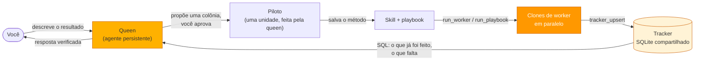

<p align="center">
  <picture>
    <source media="(prefers-color-scheme: dark)" srcset="../assets/readme/banner-dark.webp" />
    
  </picture>
</p>

<p align="center">
  <a href="../../README.md">English</a> |
  <a href="zh-CN.md">简体中文</a> |
  <a href="es.md">Español</a> |
  <a href="hi.md">हिन्दी</a> |
  <a href="pt.md">Português</a> |
  <a href="ja.md">日本語</a> |
  <a href="ru.md">Русский</a> |
  <a href="ko.md">한국어</a>
</p>

<p align="center">
  <a href="https://github.com/aden-hive/hive/blob/main/LICENSE"></a>
  <a href="https://www.ycombinator.com/companies/aden"></a>
  <a href="https://discord.com/invite/MXE49hrKDk"></a>
  <a href="https://x.com/aden_hq"></a>
  <a href="https://www.linkedin.com/company/teamaden/"></a>
</p>

<h3 align="center">Um runtime open source para colônias de agentes de IA que fazem trabalho de verdade para o seu negócio.</h3>

<p align="center">
  Diga a uma agente queen do que você precisa. Ela mesma faz a primeira parte para entender o que o trabalho exige e depois passa o resto para quantos workers em paralelo forem necessários. Cada resultado vai para um tracker compartilhado que você pode consultar, auditar e usar para retomar de onde parou.
</p>

<p align="center">
  <a href="../assets/readme/demo.mp4"></a>
  <br />
  <sub>Uma execução real. Só a digitação e a espera são aceleradas, e o selo mostra em quanto. <a href="../assets/readme/demo.mp4">Assista à execução completa (MP4)</a>.</sub>
</p>

## O que você acabou de ver

Um time de growth que está preparando um Show HN quer saber como se saíram no Hacker News os próprios lançamentos de cinco ferramentas para desenvolvedores. Veja o que o Hive fez com essa única mensagem:

1. **Você entrega a tarefa a uma queen.** As queens são agentes de longa duração, com um papel (aqui, Head of Growth) e memória e ferramentas próprias.
2. **Ela faz a única pergunta que muda a resposta:** todos os posts de lançamento ou só o lançamento original de cada produto? Você escolhe todos os lançamentos, e ela segue em frente.
3. **Ela propõe uma colônia, e você aprova.** Cinco produtos são cinco tarefas paralelas, então o chat vira uma colônia: a queen mais quantos agentes worker o trabalho exigir.
4. **Ela mesma faz uma delas.** Ela começa pelo PostHog, descobre o que conta como um post de lançamento genuíno em vez de uma menção de passagem, confere os números com a API do Hacker News e salva o método como uma skill reutilizável.
5. **Ela distribui o trabalho.** Um playbook inicia um worker por produto. Cada um segue a skill dela e grava seu resultado no tracker da colônia, uma tabela SQLite compartilhada.
6. **Ela confere cada linha antes de responder e corrige uma.** O worker do Cal.com contou um post publicado com o nome antigo, Calendso, mas esse post não era um Show HN, um Launch HN nem um lançamento da YC. Ela limpa a linha, e o gráfico mostra o Cal.com como não encontrado, e não como zero.

Nada disso foi montado de antemão. Não há grafo de workflow para desenhar: a queen molda a colônia conforme o trabalho avança, e quem controla o que já foi feito e o que falta é um tracker em disco, não uma janela de contexto.

## Início rápido

**Você vai precisar de** Python 3.11+, Node.js 20+ e git. O quickstart instala o `uv` e o `ripgrep` se estiverem faltando e se oferece para instalar o Node.

**E de um modelo.** O quickstart configura qualquer uma destas opções:

- uma chave de API da Anthropic, OpenAI, Google Gemini, Groq, Cerebras ou OpenRouter
- uma assinatura de ferramenta de código que você já paga: Claude Code, OpenAI Codex, Kimi Code, MiniMax, Z.AI ou Antigravity
- Hive LLM
- um modelo local via Ollama, sem chave nenhuma

```bash
git clone https://github.com/aden-hive/hive.git
cd hive
./quickstart.sh          # macOS / Linux
.\quickstart.ps1         # Windows (PowerShell 5.1+)
```

O quickstart cria um único ambiente Python para o workspace, guarda sua chave de API criptografada em `~/.hive`, pergunta qual modelo usar, faz o build do dashboard e o abre em `http://127.0.0.1:8787`. Da próxima vez, execute `hive open` a partir do repositório.

> [!NOTE]
> O Hive é um workspace `uv`, não um pacote pip. O `pip install -e .` instala um placeholder que não roda; use o quickstart.

**Depois,** digite uma tarefa na tela inicial e escolha a queen que vai recebê-la, ou abra a **Prompt Library** e envie um prompt pronto direto para a queen para quem ele foi escrito.

## Como funciona



O Hive tem **uma única primitiva de execução**: o agent loop. A queen é um deles, e cada worker é um clone dela, com sua própria tarefa, um conjunto mais restrito de ferramentas e um orçamento rígido. A orquestração é uma chamada de ferramenta, não um grafo compilado:

- **`run_worker`** distribui as tarefas e retorna na hora, então a queen continua conversando com você enquanto os workers rodam. Por padrão, quatro rodam ao mesmo tempo; os demais esperam a vez. O relatório de cada worker chega à conversa da queen como um novo turno.
- **O tracker** é o estado compartilhado da colônia. A queen define a tabela e em quais colunas os workers podem escrever, os workers fazem upsert de uma linha por unidade de trabalho, e a queen acompanha o progresso com SQL. É um arquivo em disco: `~/.hive/colonies/<name>/tracker/tracker.db`.
- **`run_playbook`** aplica um método já validado a todas as linhas, com retentativas e backoff, lanes com rate limit e uma lista de dead letter para as linhas que continuam falhando. "O que falta" é sempre uma consulta nova ao tracker, então rodar um playbook de novo retoma de onde ele parou.

A **[visão geral da arquitetura](../architecture/README.md)** vai mais fundo: o loop, a superfície de ferramentas, a memória, a supervisão humana e como o estado sobrevive a um crash.

<table>
  <tr>
    <td width="50%"><br /><sub><b>Tela inicial.</b> Suas queens e as colônias delas em um único mapa. Descreva uma tarefa e escolha quem vai assumi-la.</sub></td>
    <td width="50%"><br /><sub><b>Workers.</b> Um por unidade de trabalho, cada um com sua própria tarefa e orçamento, todos reportando à queen.</sub></td>
  </tr>
  <tr>
    <td width="50%"><br /><sub><b>Tracker.</b> Os resultados entram em uma tabela compartilhada à medida que os workers terminam, prontos para consultar, exportar ou retomar a partir deles.</sub></td>
    <td width="50%"><br /><sub><b>Resultado.</b> Uma resposta verificada, com fontes e gráfico, direto no chat.</sub></td>
  </tr>
</table>

## O que tem dentro

**Queens com uma função e uma memória.** O Hive vem com treze queens, cada uma com sua persona. Seis já vêm ativas (Growth, RevOps, Content, Lead Generation, Outbound e Brand & Design); contrate as demais no Org Chart ou crie as suas. Cada uma faz anotações em uma memória em markdown enquanto trabalha, e conversas anteriores relevantes são trazidas automaticamente para o contexto dela.

**Ferramentas nativas que rodam no mesmo processo.** Comandos de shell e jobs em segundo plano, edição de arquivos, busca rápida em código, PDFs, anexos e imagens, web scraping, gráficos (ECharts e Mermaid), arquivos CSV e geração de imagens com o Hive LLM. Elas rodam dentro do próprio Hive, sem nenhum servidor de ferramentas para iniciar.

**Seu navegador, controlado pelos seus agentes.** A extensão Hive Browser Bridge permite que os agentes trabalhem no seu próprio Chrome, onde você já está logado. Cada worker ganha seu próprio grupo de abas.

**Skills.** Instruções reutilizáveis no formato aberto [Agent Skills](https://agentskills.io). O Hive já vem com um conjunto delas, as queens escrevem novas quando um método se mostra eficaz, e você gerencia todas na Skills Library.

**Qualquer servidor MCP.** Adicione um com `hive mcp add`, e as ferramentas dele entram nas mesmas allowlists das nativas. O catálogo completo de integrações em [`tools/`](../../tools/src/aden_tools/tools) (GitHub, Gmail, HubSpot, Slack, Notion e muitas outras) roda como um servidor MCP; veja [docs/tools.md](../tools.md).

**Roda enquanto você está fora.** As colônias podem acordar sozinhas com gatilhos de cron, de intervalo ou de webhook. O **Sentinel**, que você ativa por colônia, observa uma queen sempre que ela para: dá um empurrão para ela seguir ou escala o caso para você pela caixa de entrada do Hive, pelo Telegram ou pelo Slack, e ela retoma assim que você responde.

**Feito para sobreviver.** Todo agente salva seu estado em disco e, depois de um crash ou reinício, retoma exatamente de onde parou. Resultados grandes de ferramentas vão para arquivos em vez de inundar o contexto, sessões longas se compactam sozinhas, turnos travados ou em loop são detectados, e todo worker roda com um orçamento rígido de chamadas de ferramenta.

**Qualquer modelo.** Tudo o que o [LiteLLM](https://docs.litellm.ai/docs/providers) suporta, incluindo OpenAI, Anthropic, Gemini, OpenRouter, Hive LLM, qualquer endpoint compatível com OpenAI e modelos locais via Ollama. Os workers podem rodar em um modelo diferente do da sua queen, e modelos só de texto continuam enxergando imagens graças a um fallback de visão.

## O Hive é para você?

O Hive mostra seu valor quando a parte difícil já não é o modelo, e sim tudo ao redor dele:

- Um processo com **muitas unidades de trabalho parecidas**, como leads, contas, tickets, repositórios ou documentos, que você quer executar em paralelo e sempre do mesmo jeito.
- Trabalho que **roda por horas ou de forma agendada** e precisa sobreviver a um reinício.
- Resultados que você precisa **conferir, consultar e auditar**, e não só ler em um chat.
- Um **humano que continua no comando** das decisões que importam.

Para um único prompt ou um script pontual, um agente comum é mais simples.

## Documentação

- [Primeiros passos](../getting-started.md): a configuração em mais detalhes
- [Visão geral da arquitetura](../architecture/README.md): como colônias, o loop, as ferramentas e a memória se encaixam
- Conceitos principais: [colônia](../key_concepts/colony.md), [queen](../key_concepts/queen.md), [workers](../key_concepts/worker_agent.md), [coordenação](../key_concepts/coordination.md), [o loop](../key_concepts/the_loop.md), [objetivos e resultados](../key_concepts/goals_outcome.md), [como as colônias melhoram](../key_concepts/improvement.md)
- [Ferramentas](../tools.md): ferramentas nativas, servidores MCP e o catálogo de integrações
- [Configuração](../configuration.md) e o [guia do desenvolvedor](../developer-guide.md)
- [Roadmap](../roadmap.md): o que a V1 entrega e o que ainda está em aberto
- [docs.adenhq.com](https://docs.adenhq.com/): documentação online

## Perguntas frequentes

**Quais modelos o Hive suporta?**
Qualquer provedor suportado pelo [LiteLLM](https://docs.litellm.ai/docs/providers), além de qualquer endpoint compatível com OpenAI. O quickstart configura os mais comuns, incluindo assinaturas de ferramentas de código como Claude Code e OpenAI Codex; o [docs/configuration.md](../configuration.md) cobre o resto.

**Posso rodar com modelos locais?**
Sim. Escolha Ollama no quickstart ou configure um modelo como `ollama/llama3` com o Ollama rodando localmente.

**Qual a diferença para outros frameworks de agentes?**
A maioria dos frameworks pede que você desenhe um grafo de agentes e conecte as entradas e saídas deles. O Hive tem um único tipo de agente: a queen é um agent loop, e cada worker é um clone dela. A orquestração acontece em tempo de execução, por meio de chamadas de ferramenta, e os agentes se coordenam por um tracker SQL compartilhado, em vez de trocar mensagens ao longo das arestas. Persistência, retomada, orçamentos, compactação e supervisão ficam nesse único loop, então todo agente já vem com eles.

**Onde ficam meus dados?**
Na sua máquina. Sessões, colônias, trackers e memória são arquivos comuns em `~/.hive` (ou onde `HIVE_HOME` apontar), e as chaves de API ficam guardadas ali, criptografadas.

**Como mantenho os custos sob controle?**
Cada worker roda com limites rígidos de turnos e de chamadas de ferramenta, então um worker travado para sozinho, e o número de workers rodando ao mesmo tempo tem um teto. Toda chamada ao modelo é contabilizada. Ainda não há limites de gasto em dólares.

**Os agentes podem usar minhas próprias ferramentas e APIs?**
Sim: pelo shell e pelo navegador nativos, por qualquer servidor MCP que você adicionar e por skills que ensinam a eles os seus procedimentos.

**O Hive é open source?**
Sim, sob a [Licença Apache 2.0](../../LICENSE).

## Contribuindo

Contribuições são bem-vindas, principalmente ferramentas, integrações e skills ([#2805](https://github.com/aden-hive/hive/issues/2805)). Leia o [CONTRIBUTING.md](../../CONTRIBUTING.md) primeiro e seja atribuído a uma issue antes de abrir um pull request: comente na issue e um mantenedor vai atribuí-la a você. Issues com passos para reproduzir ou com uma proposta concreta têm prioridade.

## Comunidade

- [Discord](https://discord.com/invite/MXE49hrKDk) para dúvidas, pedidos de funcionalidades e discussões
- [X / Twitter](https://x.com/aden_hq) e [LinkedIn](https://www.linkedin.com/company/teamaden/) para novidades
- [HoneyComb](http://honeycomb.open-hive.com/): um mercado da comunidade que acompanha quais profissões os agentes de IA estão automatizando. Aposte na alta ou na baixa de uma profissão com tokens de computação, não com dinheiro.

**Estamos contratando** para engenharia, pesquisa e go-to-market. [Veja as vagas abertas](https://jobs.adenhq.com/a8cec478-cdbc-473c-bbd4-f4b7027ec193/applicant).

## Segurança

Para reportar uma vulnerabilidade, veja o [SECURITY.md](../../SECURITY.md).

## Licença

Licença Apache 2.0. Veja o [LICENSE](../../LICENSE).

## Histórico de estrelas

<a href="https://www.star-history.com/?type=date&repos=aden-hive%2Fhive">
 <picture>
   <source media="(prefers-color-scheme: dark)" srcset="https://api.star-history.com/chart?repos=aden-hive/hive&type=date&theme=dark&legend=top-left&sealed_token=vfX1DG8w_KTkonUUtIEjFRLvBopgDzxQpyb8hiYT22sobcDIpvQiMciZghLsDu5hyU3LJs-ZddFjl8eYFx5zRrY-kcMRsfyQ3vAiacsroPoqgRYmZaES3Q" />
   <source media="(prefers-color-scheme: light)" srcset="https://api.star-history.com/chart?repos=aden-hive/hive&type=date&legend=top-left&sealed_token=vfX1DG8w_KTkonUUtIEjFRLvBopgDzxQpyb8hiYT22sobcDIpvQiMciZghLsDu5hyU3LJs-ZddFjl8eYFx5zRrY-kcMRsfyQ3vAiacsroPoqgRYmZaES3Q" />
   
 </picture>
</a>

---

<p align="center">Feito com 🔥 paixão em San Francisco</p>
